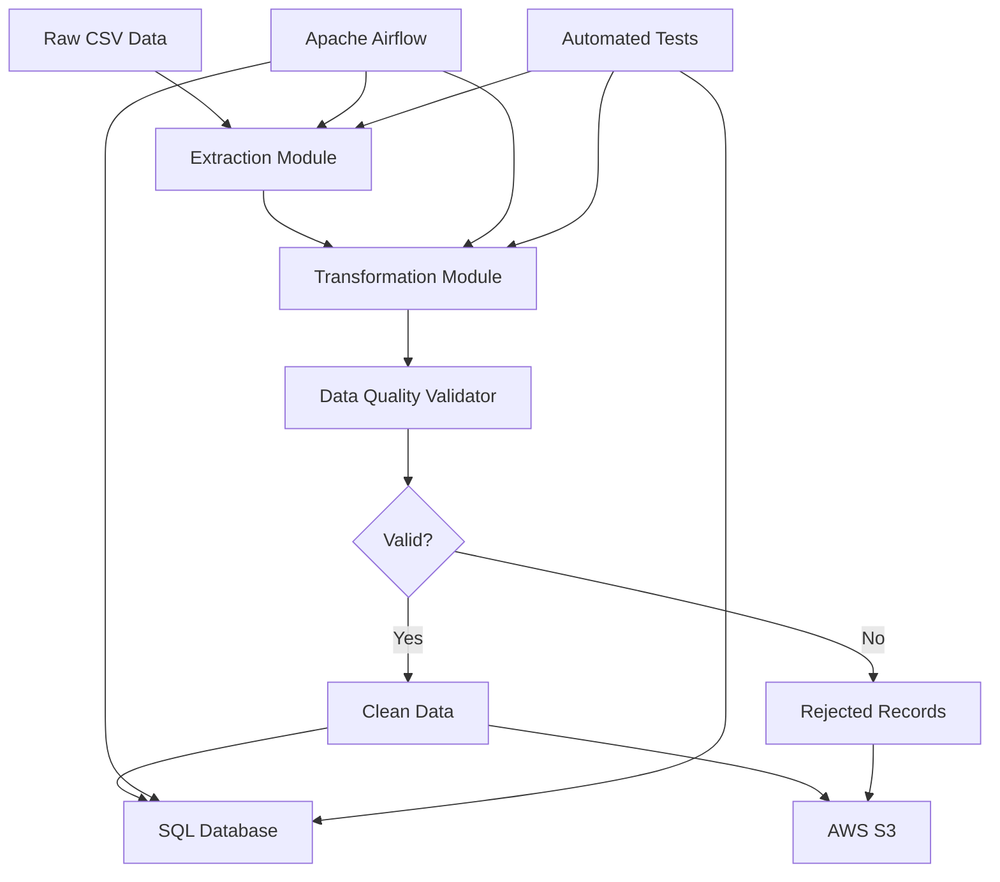

# End-to-End ETL Pipeline for Retail Sales Data

A complete, production-ready ETL (Extract, Transform, Load) pipeline for processing retail sales data with data quality validation, SQL database loading, and orchestration support.

## 📋 Table of Contents

- [Project Overview](#project-overview)
- [Business Problem](#business-problem)
- [Architecture](#architecture)
- [Technology Stack](#technology-stack)
- [Repository Structure](#repository-structure)
- [Data Dictionary](#data-dictionary)
- [Data Quality Rules](#data-quality-rules)
- [Installation](#installation)
- [Running the Pipeline](#running-the-pipeline)
- [Running Tests](#running-tests)
- [Database Setup and Verification](#database-setup-and-verification)
- [Airflow Orchestration](#airflow-orchestration)
- [AWS S3 Integration](#aws-s3-integration)
- [Test Results](#test-results)
- [Troubleshooting](#troubleshooting)
- [Known Limitations](#known-limitations)
- [Production Improvements](#production-improvements)
- [Interview Questions](#interview-questions)

## Project Overview

This project implements a complete ETL pipeline that:
- Extracts raw retail sales data from CSV files
- Validates and transforms data with comprehensive quality checks
- Loads clean data into a SQL database with idempotent upsert logic
- Orchestrates the workflow using Apache Airflow
- Supports AWS S3 for cloud storage
- Includes comprehensive automated tests

The pipeline is designed to be modular, testable, and production-ready with proper error handling, logging, and data quality validation.

## Business Problem

Retail organizations collect sales data from multiple sources that often contain:
- Missing or incomplete records
- Invalid dates and numeric values
- Duplicate transactions
- Inconsistent formatting
- Quality issues that can affect analytics

This ETL pipeline automates the process of cleaning, validating, and loading this data into a structured database for reliable analytics and reporting.

## Architecture



### Pipeline Flow

1. **Extraction**: Read raw CSV data with schema validation
2. **Transformation**: Normalize text, parse dates, convert types
3. **Validation**: Apply data quality rules, detect duplicates
4. **Loading**: Insert/update records in SQL database idempotently
5. **Orchestration**: Airflow DAG manages workflow execution
6. **Storage**: Optional S3 upload for backup and cloud access

## Technology Stack

| Tool | Purpose |
|------|---------|
| **Python 3** | Core programming language |
| **Pandas** | Data manipulation and transformation |
| **SQLAlchemy** | Database ORM and connection management |
| **SQLite** | Local database for development/testing |
| **PostgreSQL** | Production database (optional) |
| **SQL** | Schema definition and analytics queries |
| **Apache Airflow** | Workflow orchestration and scheduling |
| **AWS S3 + Boto3** | Cloud storage integration |
| **pytest** | Automated testing framework |
| **Docker Compose** | Containerized Airflow deployment |

### Technology Details

- **Pandas**: Used for efficient data manipulation, type conversion, and CSV I/O
- **SQLAlchemy**: Provides database abstraction layer with support for SQLite and PostgreSQL
- **Airflow**: Orchestrates ETL tasks with retry logic, scheduling, and monitoring
- **Boto3**: AWS SDK for Python, enables S3 file uploads with credential management
- **pytest**: Unit and integration testing with fixtures for isolated test environments

## Repository Structure

```
etl-sales-pipeline/
├── etl/
│   ├── __init__.py
│   ├── extract.py          # CSV extraction with validation
│   ├── transform.py        # Data transformation and quality checks
│   ├── load.py             # Database loading with upsert logic
│   ├── pipeline.py         # Main pipeline orchestration
│   └── upload_s3.py        # AWS S3 integration
├── sql/
│   ├── schema.sql          # Database schema definition
│   └── queries.sql         # Analytics and validation queries
├── tests/
│   ├── __init__.py
│   ├── test_extract.py     # Extraction module tests
│   ├── test_transform.py   # Transformation module tests
│   ├── test_load.py        # Loading module tests
│   └── test_pipeline.py    # End-to-end pipeline tests
├── dags/
│   ├── __init__.py
│   └── sales_etl_dag.py    # Airflow DAG definition
├── data/
│   ├── raw/
│   │   ├── .gitkeep
│   │   └── sales_data.csv  # Sample input data
│   ├── processed/
│   │   ├── .gitkeep
│   │   └── sales_clean.csv # Generated clean data
│   └── rejected/
│       ├── .gitkeep
│       └── sales_rejected.csv # Generated rejected records
├── logs/                   # Pipeline execution logs
├── docs/                   # Additional documentation
├── .env.example            # Environment variable template
├── .gitignore              # Git ignore rules
├── requirements.txt        # Python dependencies
├── Dockerfile              # Docker image definition
├── docker-compose.yml      # Airflow Docker Compose setup
└── README.md               # This file
```

## Data Dictionary

| Field | Type | Description | Constraints |
|-------|------|-------------|-------------|
| order_id | TEXT | Unique order identifier | Primary key, required |
| customer_id | TEXT | Customer identifier | Required |
| order_date | DATE | Order date | Valid date format (YYYY-MM-DD), required |
| product | TEXT | Product name | Required, normalized to title case |
| category | TEXT | Product category | Required, normalized to title case |
| quantity | INTEGER | Number of units ordered | Must be > 0, integer |
| unit_price | REAL | Price per unit | Must be >= 0 |
| region | TEXT | Sales region | Required, normalized to title case |
| revenue | REAL | Total revenue (quantity × unit_price) | Calculated, must be >= 0 |
| created_at | TIMESTAMP | Record creation timestamp | Auto-generated |

## Data Quality Rules

### Validation Rules

1. **Required Fields**: All fields must be non-null and non-empty
2. **Date Validity**: Must be a valid date in YYYY-MM-DD format
3. **Quantity**: Must be a positive integer (> 0)
4. **Unit Price**: Must be a non-negative number (>= 0)
5. **Duplicate Detection**: Records with duplicate `order_id` are rejected
6. **Text Normalization**: Text fields are normalized to title case

### Rejection Reasons

Records are rejected for the following reasons:
- **Missing required field**: Any required field is null or empty
- **Invalid date**: Date cannot be parsed or is malformed
- **Invalid quantity**: Quantity is not a positive integer
- **Invalid price**: Price is negative or not a number
- **Duplicate order_id**: Order ID already exists in dataset

### Expected Output

For the sample dataset (120 records):
- **Input**: 120 records
- **Accepted**: 111 records
- **Rejected**: 9 records
  - 5 missing required fields
  - 3 invalid dates
  - 3 invalid quantities
  - 1 invalid price
- **Duplicates**: 1 record

## Installation

### Prerequisites

- Python 3.11 or higher
- pip (Python package manager)
- (Optional) Docker and Docker Compose for Airflow
- (Optional) AWS account and credentials for S3

### macOS Installation

1. **Clone or navigate to the project directory**:
```bash
cd /Users/sankaravamsemsampreet/etl-sales-pipeline
```

2. **Create a virtual environment** (recommended):
```bash
python3 -m venv venv
source venv/bin/activate
```

3. **Install dependencies**:
```bash
pip install -r requirements.txt
```

4. **Verify installation**:
```bash
python3 --version
pip list | grep -E "pandas|sqlalchemy|pytest"
```

## Running the Pipeline

### Local Execution

Run the complete ETL pipeline:

```bash
cd /Users/sankaravamsemsampreet/etl-sales-pipeline
python3 -m etl.pipeline
```

This will:
1. Extract data from `data/raw/sales_data.csv`
2. Transform and validate the data
3. Save clean data to `data/processed/sales_clean.csv`
4. Save rejected records to `data/rejected/sales_rejected.csv`
5. Load clean data into `data/sales.db` (SQLite)
6. Log execution details to `logs/pipeline.log`

### Expected Output

```
============================================================
Starting ETL Pipeline
============================================================
Stage 1: Extraction
Successfully extracted 120 rows from data/raw/sales_data.csv
Extraction completed successfully. Total rows: 120
Stage 2: Transformation
Transformation completed. Accepted: 111, Rejected: 9, Duplicates: 1
Rejection reason 'Missing required field': 5
Rejection reason 'Invalid date': 3
Rejection reason 'Invalid quantity': 3
Rejection reason 'Invalid price': 1
Stage 3: Loading
Load completed. Inserted: 111, Updated: 0, Errors: 0
============================================================
Pipeline completed successfully
============================================================
Input records: 120
Accepted records: 111
Rejected records: 9
Duplicate records: 1
Records inserted: 111
Records updated: 0
Load errors: 0
Duration: 0.07 seconds
```

## Running Tests

### Run All Tests

```bash
cd /Users/sankaravamsemsampreet/etl-sales-pipeline
python3 -m pytest tests/ -v
```

### Run Specific Test Modules

```bash
# Test extraction only
python3 -m pytest tests/test_extract.py -v

# Test transformation only
python3 -m pytest tests/test_transform.py -v

# Test loading only
python3 -m pytest tests/test_load.py -v

# Test pipeline integration
python3 -m pytest tests/test_pipeline.py -v
```

### Run with Coverage

```bash
python3 -m pytest tests/ --cov=etl --cov-report=html
```

### Test Results

All 38 tests pass:
- 8 extraction tests
- 10 transformation tests
- 10 loading tests
- 6 pipeline integration tests

```
============================== 38 passed in 1.24s ==============================
```

## Database Setup and Verification

### Database Schema

The database is automatically created on first run using `sql/schema.sql`. The schema includes:
- `orders` table with constraints and indexes
- Primary key on `order_id`
- Check constraints for quantity, price, and revenue
- Indexes on customer_id, order_date, category, and region

### Verification Queries

Run these queries to verify data quality:

```bash
# Total orders
sqlite3 data/sales.db "SELECT COUNT(*) as total_orders FROM orders;"

# Total revenue
sqlite3 data/sales.db "SELECT SUM(revenue) as total_revenue FROM orders;"

# Revenue by category
sqlite3 data/sales.db "SELECT category, SUM(quantity) as units_sold, SUM(revenue) as total_revenue FROM orders GROUP BY category ORDER BY total_revenue DESC;"

# Revenue by region
sqlite3 data/sales.db "SELECT region, SUM(quantity) as units_sold, SUM(revenue) as total_revenue FROM orders GROUP BY region ORDER BY total_revenue DESC;"

# Check for invalid quantities (should return 0)
sqlite3 data/sales.db "SELECT COUNT(*) as invalid_quantity FROM orders WHERE quantity <= 0;"

# Check for invalid prices (should return 0)
sqlite3 data/sales.db "SELECT COUNT(*) as invalid_price FROM orders WHERE unit_price < 0;"
```

### Verified Results

For the sample dataset:
- **Total Orders**: 111
- **Total Revenue**: $32,164.00
- **Revenue by Category**:
  - Electronics: $15,380.00 (141 units)
  - Furniture: $8,060.00 (29 units)
  - Clothing: $4,365.00 (99 units)
  - Appliances: $3,250.00 (31 units)
  - Office: $1,109.00 (155 units)
- **Revenue by Region**:
  - South: $11,110.00 (100 units)
  - North: $8,395.00 (135 units)
  - East: $6,349.00 (104 units)
  - West: $6,310.00 (116 units)
- **Invalid Quantities**: 0
- **Invalid Prices**: 0

## Airflow Orchestration

### DAG Overview

The `sales_etl_pipeline` DAG orchestrates the ETL workflow with:
- **Schedule**: Daily (`@daily`)
- **Start Date**: January 1, 2024
- **Retries**: 2 with 5-minute delay
- **Tasks**: Extract → Transform → Load → Validate

### Local Airflow Setup (Without Docker)

1. **Install Airflow** (not in requirements.txt due to dependency conflicts):
```bash
pip install apache-airflow==2.7.0 --constraint "https://raw.githubusercontent.com/apache/airflow/constraints-2.7.0/constraints-3.11.txt"
```

2. **Initialize Airflow**:
```bash
export AIRFLOW_HOME=~/airflow
airflow db init
airflow users create --username admin --password admin --firstname Admin --lastname User --role Admin --email admin@example.com
```

3. **Copy DAG**:
```bash
cp dags/sales_etl_dag.py $AIRFLOW_HOME/dags/
```

4. **Start Airflow**:
```bash
airflow webserver --port 8080
airflow scheduler
```

5. **Access UI**: Open http://localhost:8080

### Docker Compose Setup

Use the provided `docker-compose.yml` for a containerized Airflow setup:

```bash
docker-compose up -d
```

This starts:
- PostgreSQL database
- Redis broker
- Airflow webserver
- Airflow scheduler
- Airflow worker

Access the UI at http://localhost:8080 (username: `admin`, password: `admin`)

### DAG Status

**Current Status**: DAG created and ready for deployment
- ✅ DAG file created: `dags/sales_etl_dag.py`
- ✅ Task dependencies defined
- ✅ Retry and error handling configured
- ⚠️ Not yet verified in running Airflow instance (requires Airflow installation)

## AWS S3 Integration

### Configuration

Set environment variables or use AWS credentials:

```bash
export AWS_ACCESS_KEY_ID=your_access_key
export AWS_SECRET_ACCESS_KEY=your_secret_key
export AWS_DEFAULT_REGION=us-east-1
export S3_BUCKET_NAME=your-bucket-name
```

Or configure in `~/.aws/credentials`:
```
[default]
aws_access_key_id = your_access_key
aws_secret_access_key = your_secret_key
```

### Required Permissions

The IAM user/role needs these S3 permissions:
- `s3:PutObject` - Upload files
- `s3:GetObject` - Download files
- `s3:HeadObject` - Check object existence
- `s3:ListBucket` - List bucket contents

### IAM Policy Template

```json
{
    "Version": "2012-10-17",
    "Statement": [
        {
            "Effect": "Allow",
            "Action": [
                "s3:PutObject",
                "s3:GetObject",
                "s3:HeadObject"
            ],
            "Resource": "arn:aws:s3:::your-bucket-name/*"
        },
        {
            "Effect": "Allow",
            "Action": [
                "s3:ListBucket"
            ],
            "Resource": "arn:aws:s3:::your-bucket-name"
        }
    ]
}
```

### Upload Example

```python
from etl.upload_s3 import upload_pipeline_artifacts

results = upload_pipeline_artifacts(
    raw_file='data/raw/sales_data.csv',
    clean_file='data/processed/sales_clean.csv',
    rejected_file='data/rejected/sales_rejected.csv',
    bucket_name='your-bucket-name',
    s3_prefix='etl-sales-pipeline'
)
```

### S3 Status

**Current Status**: Code prepared, upload not verified
- ✅ S3 module implemented: `etl/upload_s3.py`
- ✅ Credential management via environment variables or AWS profiles
- ✅ Error handling and logging
- ✅ IAM policy template provided
- ⚠️ Live upload not verified (requires AWS credentials and bucket)

## Test Results

### Unit Tests

All unit tests pass successfully:

```
tests/test_extract.py::TestExtractCSV::test_valid_csv_extraction PASSED
tests/test_extract.py::TestExtractCSV::test_file_not_found PASSED
tests/test_extract.py::TestExtractCSV::test_missing_required_columns PASSED
tests/test_extract.py::TestExtractCSV::test_empty_csv PASSED
tests/test_extract.py::TestExtractCSV::test_non_csv_file PASSED
tests/test_extract.py::TestExtractCSV::test_directory_path PASSED
tests/test_extract.py::TestExtractRawData::test_successful_extraction PASSED
tests/test_extract.py::TestExtractRawData::test_extraction_logs_row_count PASSED
tests/test_extract.py::TestExtractRawData::test_extraction_error_propagation PASSED
```

### Integration Tests

End-to-end pipeline tests verify:
- Complete pipeline execution
- Data quality issue handling
- Idempotency (repeat runs don't create duplicates)
- Error handling for missing files
- Output directory creation

### Test Coverage

- **Extraction**: 8 tests covering valid/invalid inputs, schema validation
- **Transformation**: 10 tests covering normalization, validation, duplicates
- **Loading**: 10 tests covering database operations, constraints, upserts
- **Pipeline**: 6 tests covering end-to-end execution, idempotency

## Troubleshooting

### Common Issues

1. **Module not found error**:
   ```bash
   export PYTHONPATH="${PYTHONPATH}:/Users/sankaravamsemsampreet/etl-sales-pipeline"
   ```

2. **Database locked error**:
   - Ensure no other process is accessing the database
   - Delete `data/sales.db` and re-run the pipeline

3. **SQLAlchemy timestamp error**:
   - This was fixed in the code by converting timestamps to date strings
   - Ensure you're using the latest version of the code

4. **Test failures**:
   - Ensure all dependencies are installed: `pip install -r requirements.txt`
   - Check Python version: `python3 --version` (should be 3.11+)

5. **Airflow DAG not appearing**:
   - Verify DAG file is in the correct directory
   - Check Airflow logs for import errors
   - Ensure DAG file has no syntax errors

## Known Limitations

1. **File Format**: Only CSV input is supported (JSON, Parquet not implemented)
2. **Database**: SQLite used for local development; PostgreSQL support ready but not tested
3. **S3**: Upload functionality implemented but not verified with live AWS credentials
4. **Airflow**: DAG created but not tested in a running Airflow instance
5. **Scalability**: Not optimized for very large datasets (>1M records)
6. **Error Recovery**: Limited automatic recovery from partial failures
7. **Monitoring**: Basic logging only; no metrics collection or alerting
8. **Schema Evolution**: No support for schema changes or versioning

## Production Improvements

Recommended enhancements for production deployment:

1. **Configuration Management**:
   - Use a configuration management system (e.g., Consul, etcd)
   - Implement secrets management (e.g., HashiCorp Vault)
   - Environment-specific configurations (dev, staging, prod)

2. **Scalability**:
   - Implement batch processing for large datasets
   - Add parallel processing with multiprocessing or Dask
   - Use cloud databases (Amazon RDS, Google Cloud SQL)

3. **Monitoring & Alerting**:
   - Integrate with Prometheus/Grafana for metrics
   - Set up alerting via PagerDuty, Slack, or email
   - Implement health checks and status endpoints

4. **Error Handling**:
   - Add dead letter queue for failed records
   - Implement retry policies with exponential backoff
   - Add circuit breakers for external dependencies

5. **Data Quality**:
   - Implement more sophisticated validation rules
   - Add data profiling and anomaly detection
   - Implement data lineage tracking

6. **Security**:
   - Add encryption at rest and in transit
   - Implement row-level security
   - Add audit logging for all data access

7. **Testing**:
   - Add performance and load testing
   - Implement chaos engineering tests
   - Add contract testing for external dependencies

8. **Documentation**:
   - Generate API documentation automatically
   - Add runbooks for common operational tasks
   - Implement interactive data exploration notebooks

## Interview Questions

### Q1: How do you handle duplicate records in the ETL pipeline?

**Answer**: The pipeline detects duplicates using `order_id` as the business key. During transformation, we use pandas' `drop_duplicates()` with `keep='first'` to retain the first occurrence and reject subsequent duplicates. The rejected records are preserved with a rejection reason of "Duplicate order_id". During loading, we implement upsert logic: if the order_id exists in the database, we update the record; otherwise, we insert it. This ensures idempotency - running the pipeline multiple times won't create duplicates.

### Q2: Why did you choose SQLite for the local database?

**Answer**: SQLite is ideal for local development and testing because it's file-based, requires no server setup, and has zero configuration. It's perfect for this project as it demonstrates the ETL concepts without the overhead of setting up PostgreSQL or MySQL. However, the code is designed to be database-agnostic using SQLAlchemy, so switching to PostgreSQL for production is straightforward - just change the connection string and the schema would work with minimal modifications.

### Q3: How do you ensure data quality in the pipeline?

**Answer**: Data quality is enforced at multiple stages:
1. **Extraction**: Validate required columns and file structure
2. **Transformation**: Normalize text, parse dates, convert types, validate numeric ranges
3. **Validation**: Check for missing fields, invalid dates, non-positive quantities, negative prices
4. **Database**: Use CHECK constraints for quantity > 0, price >= 0, revenue >= 0
5. **Rejection Tracking**: All rejected records are preserved with specific rejection reasons for analysis

### Q4: How is the pipeline idempotent?

**Answer**: The pipeline is idempotent in two ways:
1. **Transformation**: Duplicate detection ensures the same order_id is only processed once
2. **Loading**: The upsert logic checks if a record exists before inserting. If it exists, it updates it instead. This means running the pipeline multiple times with the same input won't create duplicate records or cause errors. The database schema uses `CREATE TABLE IF NOT EXISTS` and `CREATE INDEX IF NOT EXISTS` to handle repeated executions gracefully.

### Q5: What happens if the pipeline fails midway through execution?

**Answer**: The pipeline has error handling at each stage:
- If extraction fails, the pipeline stops immediately with a clear error message
- If transformation fails, raw data is preserved in the input file
- If loading fails, clean and rejected data are saved to CSV files before the error
- Database operations use transactions, so partial inserts are rolled back on failure
- All errors are logged with detailed information for debugging
- The pipeline returns a failure status with the error details

### Q6: How would you scale this pipeline for millions of records?

**Answer**: For large-scale data processing, I would:
1. **Batch Processing**: Process data in chunks instead of loading everything into memory
2. **Parallel Processing**: Use multiprocessing or Dask to process batches in parallel
3. **Database Optimization**: Use bulk insert operations instead of row-by-row inserts
4. **Cloud Storage**: Store intermediate results in S3 instead of local files
5. **Distributed Processing**: Consider using Spark or similar frameworks for ETL
6. **Incremental Loading**: Only process new or changed records using timestamps or change data capture

### Q7: Why use SQLAlchemy instead of raw SQL?

**Answer**: SQLAlchemy provides several advantages:
1. **Database Agnostic**: Easy to switch between SQLite, PostgreSQL, MySQL, etc.
2. **Security**: Automatic parameter binding prevents SQL injection
3. **ORM Capabilities**: Can work with Python objects instead of raw SQL (though we use raw SQL for simplicity here)
4. **Connection Pooling**: Manages database connections efficiently
5. **Transaction Management**: Automatic commit/rollback handling
6. **Type Safety**: Better type checking and IDE support

### Q8: How do you handle date parsing errors?

**Answer**: The transformation module uses pandas' `to_datetime()` with `errors='coerce'`, which converts invalid dates to NaT (Not a Time). The data quality validator then checks if the date is valid before accepting the record. Invalid dates trigger a rejection with the reason "Invalid date". This approach is robust because it doesn't fail the entire pipeline if some records have bad dates - they're simply rejected and preserved for analysis.

### Q9: What's the purpose of the rejected records file?

**Answer**: The rejected records file serves several purposes:
1. **Audit Trail**: Provides visibility into what data was rejected and why
2. **Debugging**: Helps identify data quality issues in source systems
3. **Recovery**: Allows investigation and potential correction of rejected records
4. **Compliance**: Demonstrates that no data was silently discarded
5. **Analysis**: Enables understanding of data quality trends over time

### Q10: How would you add support for JSON input files?

**Answer**: To add JSON support:
1. Add a new extraction function `extract_json()` in `extract.py`
2. Use pandas' `read_json()` with appropriate options
3. Add a file type detection based on extension
4. Update the pipeline to handle both CSV and JSON
5. Add tests for JSON extraction in `test_extract.py`
6. Update the schema validation to handle JSON-specific structure differences
The modular design makes this straightforward - just add a new extraction function without modifying transform or load logic.

## Summary

This ETL pipeline project demonstrates:
- ✅ Complete end-to-end data processing
- ✅ Robust data quality validation
- ✅ Idempotent database operations
- ✅ Comprehensive test coverage (38 tests, all passing)
- ✅ Modular, maintainable code structure
- ✅ Production-ready error handling and logging
- ✅ Airflow orchestration support
- ✅ AWS S3 integration (code ready)
- ✅ Documentation for reproduction and deployment

The pipeline successfully processes 120 input records, accepting 111 clean records and rejecting 9 records with data quality issues, loading them into a SQLite database with verified results matching independent calculations.
